# Laporan Praktikum 6

**UNIVERSITAS PELITA BANGSA**

- **Nama:** Jumari
- **NIM:** 312510077
- **Mata Kuliah:** Struktur Data


## A. Identitas dan Capaian Praktikum

| Detail          | Keterangan                                                                             |
| --------------- | -------------------------------------------------------------------------------------- |
| **Mata Kuliah** | Pemrograman Web                                                                        |
| **Pertemuan**   | 7                                                                                      |
| **Topik**       | JavaScript DOM dan event handling                                                      |
| **Cakupan**     | Pemilihan dan manipulasi elemen, event listener, validasi form, dan interaksi pengguna |
| **Perangkat**   | Laptop/PC, browser modern, editor kode seperti Visual Studio Code                      |

## B. Tujuan Praktikum

1. Memahami DOM sebagai representasi dokumen HTML yang dapat diakses melalui JavaScript.
2. Menggunakan `id`, `class`, dan selector CSS untuk memilih elemen HTML.
3. Mengubah teks, atribut, kelas CSS, dan gaya elemen melalui JavaScript.
4. Menangani event pengguna menggunakan `addEventListener()`.
5. Membuat validasi form dan menampilkan pesan sesuai kondisi input.
6. Mengembangkan halaman interaktif dengan minimal tiga fungsi yang berjalan benar.

## C. Latihan

### 1. Buat Struktur Html

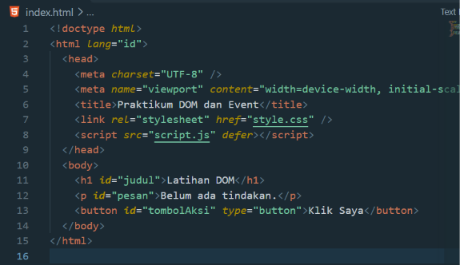

Atribut `defer` membuat JavaScript dijalankan setelah HTML selesai diparsing, sehingga elemen yang dipilih sudah tersedia.

### 2. Mengubah teks DOM berdasarkan 'id' pada Javascript menggunakan textContent

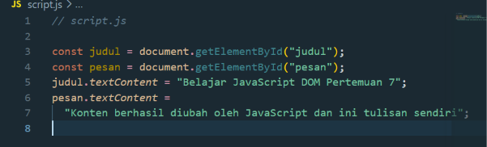

### 3. Event Click

a. Karena adanya kesalahan pada penulisan syntax javascript berdasarkan modul yaitu variabel pesan ditulis dua kali

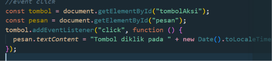

b. Jadi saya memperbaiki dengan menghilangkan `const.pesan` dibawah `const tombol`

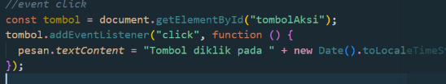

### 4. Hasil HTML sampai event click

a. Base Html tanpa Javascript

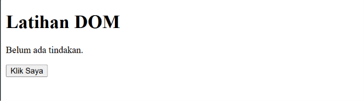

b. Setelah ditambahkan javascript untuk mengubah teks dengan DOM

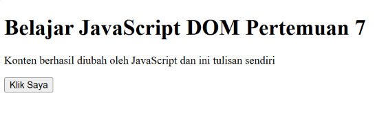

c. Menambahkan syntax `addEventListener` pada Klik Saya, akan menghasilkan tanggal di klik.

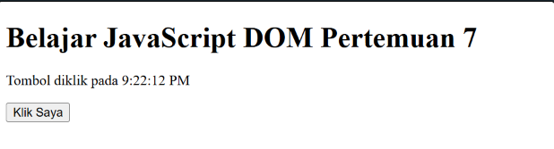

### 5. Mengubah Kelas dan Gaya CSS

Mengatur CSS berikut ke `style.css` dan buat paragraf id `teksGaya` serta tombol id `tombolGaya`.

a. Namun pada modul yang diberikan, terdapat kesalahan syntax yaitu `tombolGaya` belum terdefinisi pada `index.html` dan syntax `const` tidak ada di css

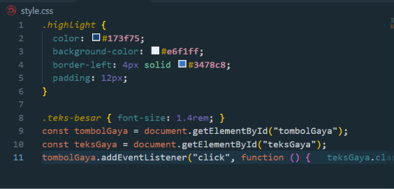

Sehingga hasil tidak berubah

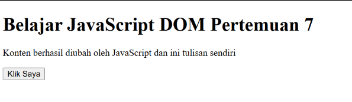

b. Memperbaiki kesalahan penulisan

- Menambah syntax pada `index.html`

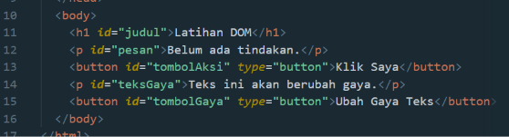

- Mengubah syntax `script.js`

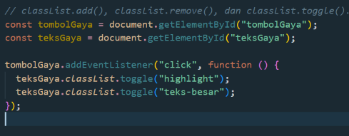

- Mengubah syntax `style.css`

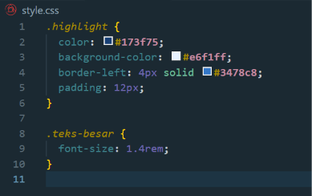

c. Sehingga Hasil

- Setelah penambahan pada paragraf html

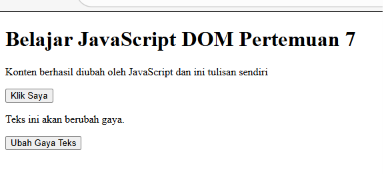

- Jika di klik Ubah Gaya Teks

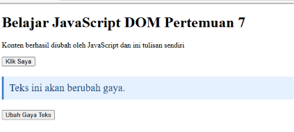

### 6. Even Input dan Penghitung Karakter

a. Tambahkan label input pada html

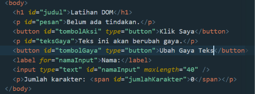

Hasil

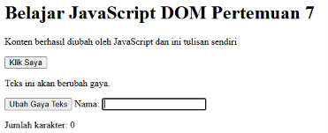

b. Menambah syntax javascript sehingga jumlah karakter berfungsi

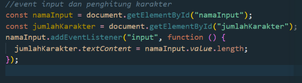

Hasil setelah menambah syntax html dan javascript

jumlah karakter bertambah disetiap

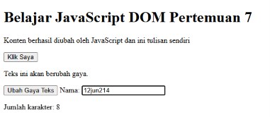

### 7. Validasi Form Pendaftaran

Buat form nama, email, dan usia. Program menampilkan pesan jika input tidak sesuai.

a. Membuat form pendaftaran di html

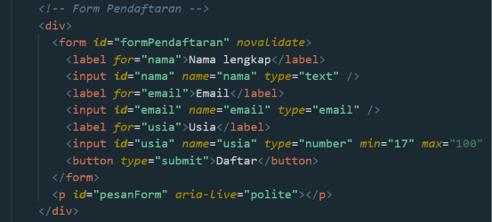

b. Menciptakan peraturan terkait pengisian form menggunakan javascript

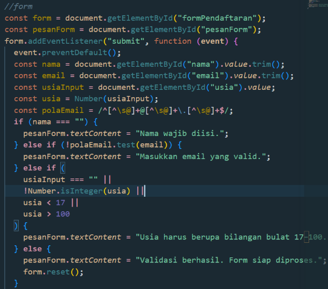

Hasil jika semua kosong, nama kosong, email tidak valid, usia di bawah 17, dan semua input valid.

- semua Kosong

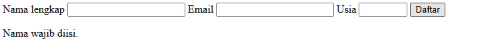

- nama tidak valid

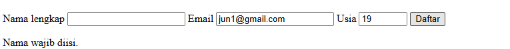

- email tidak valid

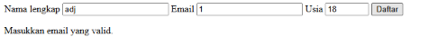

- usia dibawah 17

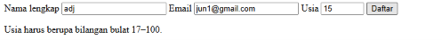

- semua input valid. saat validasi berhasil, form kembali kosong

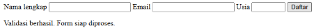

### 8. To Do List

a. Membuat daftar tugas dibungkus section pada html

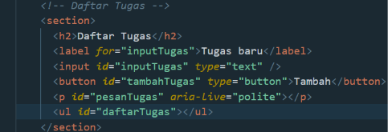

b. Mengatur logika daftar tugas di javascript

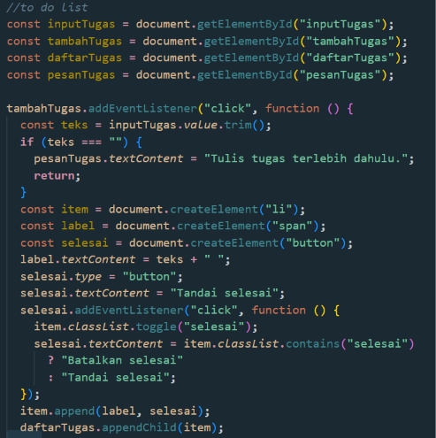

c. Merapihkan hasil daftar tugas yang ditambahkan menggunakan css list

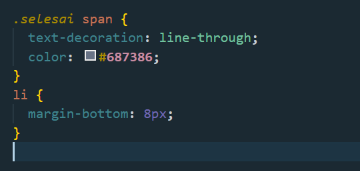

d. Hasil

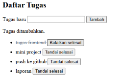

## D. Mini Project

Judul = "Form Pendaftaran Workshop"

Kembangkan halaman pendaftaran workshop dengan minimal tiga fungsi interaktif.

- Validasi nama, email, dan pilihan sesi.
- Penghitung karakter atau ringkasan input secara langsung.
- Pesan kesalahan dan pesan sukses yang tampil pada halaman.
- Tombol reset atau hapus input.

Gunakan `addEventListener()` untuk event `input`, `change`, `click`, atau `submit`.

Struktur Folder dan File

```
miniproject
├── index.html
├── script.js
└── style.css
```

### 1. Input Nama dan Penghitung Karakter

a. HTML

Atribut `maxlength="50"` membatasi pengguna agar tidak mengetik lebih dari 50 karakter. Elemen `<span id="jumlahKarakter">0</span>` disiapkan sebagai wadah kosong yang angkanya akan diubah oleh JavaScript.

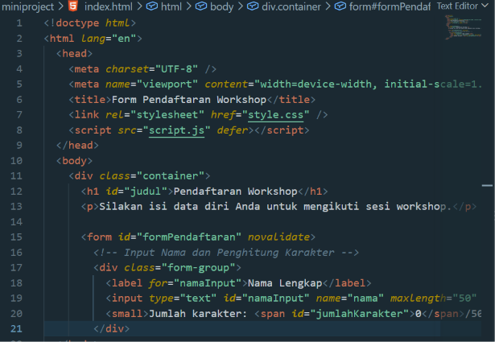

b. Css

Css membuat input teks mengisi lebar penuh kontainernya (`width: 100%`) agar mudah diklik. Elemen `<small>` diberi warna abu-abu agar visualnya tidak mendominasi layar utama.

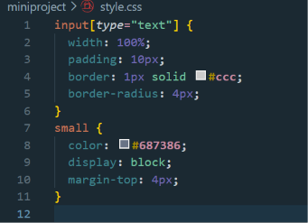

c. Javascript

Event `input` akan memicu fungsi setiap kali pengguna mengetik atau menghapus karakter. Properti `.value.length` mengambil total karakter saat ini dan mencetaknya ke dalam elemen `jumlahKarakter`. Pada bagian validasi saat disubmit, `namaInput.value.trim()` digunakan untuk memastikan spasi kosong di awal/akhir tidak dihitung sebagai nama.

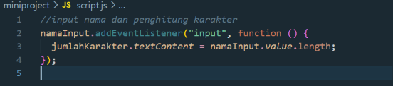

d. Hasil

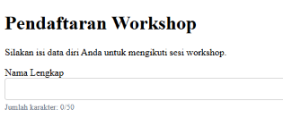

### 2. Input Email

a. HTML

Penggunaan `type="email"` memberikan validasi bawaan dari browser, serta memunculkan keyboard khusus email (dengan tombol '@') jika dibuka melalui smartphone.

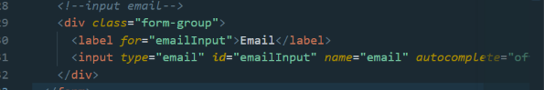

b. Css

mengaturnya melalui `.form-group`

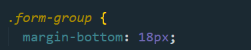

c. Javascript

JavaScript menggunakan Regular Expression (Regex) `polaEmail` untuk memverifikasi struktur teks. Fungsi `.test(email)` akan mengembalikan nilai `true` jika struktur email valid, dan `false` jika tidak valid (memunculkan pesan error).

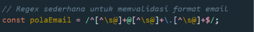

### 3. Pilihan Sesi

a. HTML

Elemen `<select>` membungkus beberapa `<option>`. Opsi pertama dibiarkan dengan `value=""` sebagai placeholder (teks instruksi).

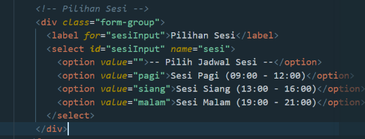

b. Css

Pemilihan `font-size: 1rem` sangat penting pada perangkat mobile (khususnya iOS) agar browser tidak otomatis melakukan zoom-in saat form dropdown diklik.

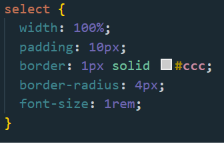

c. Javascript

Membaca properti `value` dari elemen `select`. Jika nilainya masih kosong (artinya pengguna belum memilih selain opsi placeholder), pendaftaran ditahan dan error ditampilkan.
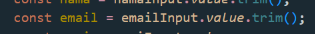
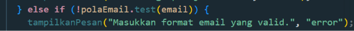

### 4. Tombol Aksi

a. HTML

Atribut `type="submit"` akan memicu event `submit` pada form pembungkusnya, sedangkan `type="reset"` otomatis mengosongkan semua isian form bawaan HTML tanpa perlu kode JavaScript tambahan.

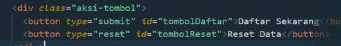

b. Css

Flexbox digunakan pada kontainer `.aksi-tombol` dengan `flex: 1` pada `<button>`, sehingga kedua tombol akan merentang sejajar dan membagi lebar ruang (50%: 50%) secara otomatis.

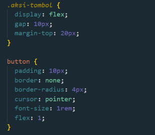

c. Javascript

Method `event.preventDefault()` pada tombol submit sangat vital karena perilaku bawaan browser saat form dikirim adalah memuat ulang (reload) halaman. Untuk tombol reset, event `click` ditambahkan guna mereset elemen manipulasi DOM (seperti angka karakter dan pesan error) yang tidak bisa direset oleh mekanisme bawaan HTML.

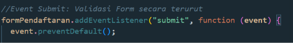
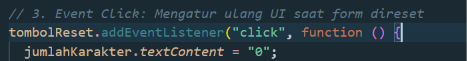

### 5. Area Pesan Notifikasi

Wadah dinamis untuk memberikan umpan balik (feedback) visual kepada pengguna apakah tindakan mereka gagal atau berhasil.

a. HTML

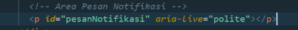

b. Css

Secara default pesan ini disembunyikan (`display: none`). Kelas `error` dan `sukses` bertugas memberikan warna (merah untuk gagal, biru untuk sukses) sekaligus memunculkan elemen tersebut (`display: block !important`).

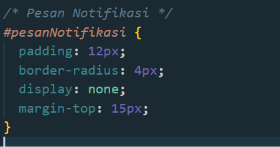

c. Javascript

Fungsi ini menyuntikkan teks yang diberikan ke dalam paragraf, lalu menimpa atribut kelasnya (menggunakan properti `.className`) menjadi "error" atau "sukses" berdasarkan hasil kondisi validasi (`if-else`) pada bagian event submit.

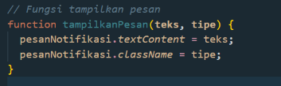

Hasil Mini Project Keseluruhn

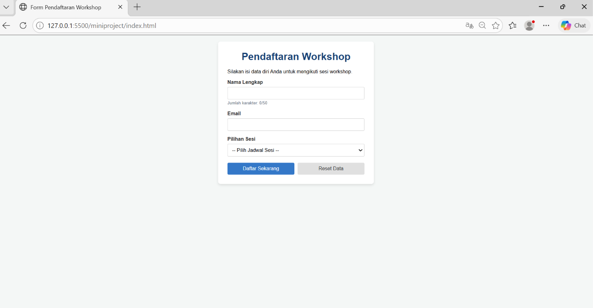
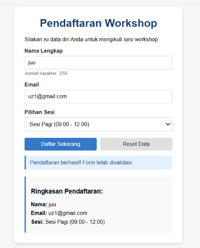


## E. Pertanyaan Evaluasi

### 1. DOM (Document Object Model) dan Manfaatnya

- **Pengertian:** DOM adalah antarmuka pemrograman (API) yang merepresentasikan dokumen HTML atau XML sebagai struktur pohon (tree). Setiap elemen, atribut, dan teks di dalam dokumen diubah menjadi objek (node) yang bisa diakses.
- **Manfaat:** Memungkinkan bahasa pemrograman seperti JavaScript untuk berinteraksi dengan halaman web secara dinamis seperti menambah, mengubah, atau menghapus elemen dan desain (CSS) tanpa perlu memuat ulang (refresh) halaman.

### 2. Perbedaan `getElementById()`, `querySelector()`, dan `querySelectorAll()`

- `getElementById()`: Memilih satu elemen secara spesifik berdasarkan atribut `id`. Performanya sangat cepat, namun terbatas hanya untuk ID.
- `querySelector()`: Memilih satu elemen pertama yang cocok dengan selektor CSS apa pun (seperti `.class`, `#id`, atau tag). Lebih lambat dari pencarian ID, tetapi sangat fleksibel.
- `querySelectorAll()`: Memilih semua elemen yang cocok dengan selektor CSS dan mengembalikannya dalam bentuk kumpulan data statis bernama `NodeList`.

### 3. Fungsi `addEventListener()` dan Tiga Contoh Event

**Fungsi:** Metode ini digunakan untuk "mendengarkan" dan merespons interaksi pada suatu elemen dengan menjalankan fungsi (callback) ketika event terjadi, tanpa menimpa event listener lain yang sudah ada pada elemen tersebut.

**Contoh Event:**

- `click`: Terpicu ketika pengguna mengklik elemen (misal: mengklik tombol kirim).
- `submit`: Terpicu ketika pengguna mengirimkan (submit) sebuah form.
- `keydown`: Terpicu ketika pengguna menekan tombol apa saja pada keyboard.

### 4. Mengapa `event.preventDefault()` Digunakan pada Event Submit Form?

Secara bawaan (default), ketika form disubmit, browser akan memuat ulang halaman untuk mengirim data ke server. `event.preventDefault()` memblokir perilaku bawaan ini sehingga Anda bisa memproses, memvalidasi, atau mengirim data secara asinkron (misalnya menggunakan Fetch API atau AJAX) tanpa kehilangan status (state) pada halaman web yang sedang aktif.

### 5. Perbedaan `textContent` dan `innerHTML` (Penggunaan dan Keamanan)

**Penggunaan:**

- `textContent` mengatur atau mengekstrak konten murni sebagai teks biasa. Jika Anda memasukkan tag HTML, tag tersebut akan dicetak mentah-mentah di layar.
- `innerHTML` mengatur atau mengekstrak konten dalam format HTML. Tag yang dimasukkan (misal `<b>teks</b>`) akan diproses dan dirender langsung oleh browser.


**Keamanan:**

- `textContent` aman dari serangan Cross-Site Scripting (XSS) karena semua karakter diperlakukan sebagai string murni.
- `innerHTML` sangat rentan terhadap XSS jika menerima input pengguna tanpa disanitasi, karena script berbahaya (`<script>`) dapat dimasukkan dan dieksekusi.

### 6. Bagaimana `classList.toggle()` Membantu Mengubah Tampilan Elemen?

`classList.toggle()` bekerja seperti tombol sakelar $(on/off)$. Jika class CSS tertentu belum ada pada elemen, metode ini akan menambahkannya. Jika class tersebut sudah ada, metode ini akan menghapusnya. Hal ini menyingkirkan kebutuhan logika `if-else` manual dan membuat kode jauh lebih bersih saat membangun fitur seperti dark mode atau membuka-tutup menu dropdown.

### 7. Tiga Skenario Pengujian Validasi Form

- **Uji Input Kosong (Required Fields):** Memastikan sistem menolak formulir dan memunculkan error jika pengguna membiarkan kolom wajib (seperti nama atau alamat email) tetap kosong.
- **Uji Format Data (Pattern/Type Matching):** Memastikan data yang diinput sesuai dengan format yang diminta. Misalnya, kolom email harus memiliki simbol @ dan nama domain, atau kolom nomor telepon tidak boleh menerima huruf.
- **Uji Batasan Nilai (Boundary/Length):** Memeriksa batasan karakter dan angka, seperti memvalidasi bahwa password harus berjumlah minimal 8 karakter atau batasan umur pengguna tidak boleh bernilai negatif.

